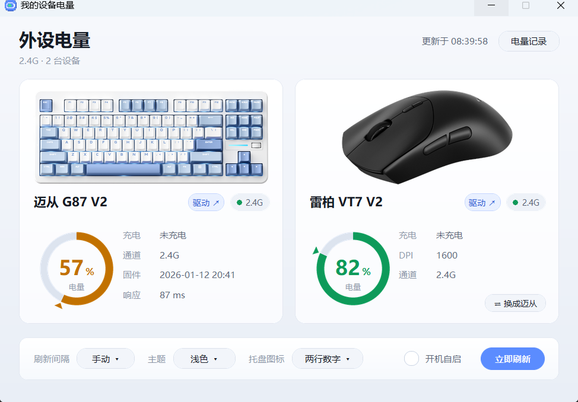
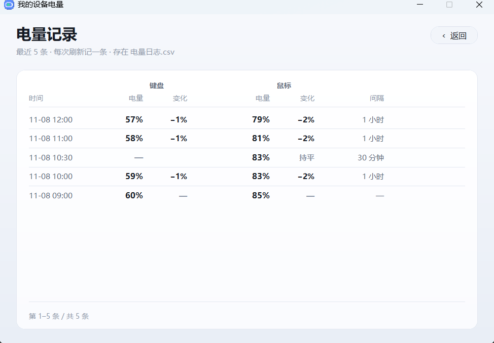

# 外设电量 · Peripheral Battery

> 一个只管一件事的 Windows 小工具：把无线键盘和鼠标的电量常驻在托盘，点开看详情，
> 顺手记一份电量日志，方便估算「一格电到底能用多久」。

A tiny Windows tray app that shows the battery level of a wireless keyboard and mouse.
Written with the Python standard library only — no third-party runtime dependencies,
no network access, no telemetry.



## 它做什么

- **托盘常驻**：默认上下两行数字（上键盘、下鼠标），鼠标悬停显示 `键盘 57%｜鼠标 81%`。
  也可以切成两个独立图标。图标颜色跟着任务栏深浅自动换 —— 白任务栏用深色，黑任务栏用亮色。
- **图形面板**：产品图 + 环形电量 + 充电状态、连接通道、固件日期、DPI、响应耗时。
  整窗是一块 Canvas 手绘的，按设计稿坐标 × DPI 缩放，100% / 150% / 200% 下版式一致。
- **电量日志**：每次刷新记一条，存在程序旁边的 `电量日志.csv`（Excel / WPS 双击可开）。
  面板里有「电量记录」入口，同一时刻的键盘和鼠标合成一行，带「间隔」和「变化」两列，
  看得出一小时掉了几个百分点。鼠标停到某行才出现删除按钮，点两次才真删。
- **开机自启**：写进启动文件夹的快捷方式，不用注册表。
- **读不到就说读不到**：设备休眠时显示「上次读数 + 时间」，绝不把缓存值当实时值、
  更不会显示成 0%。



## 支持哪些设备

只实测过下面这几款。同一品牌的其他型号**不保证能用** —— 电量走的是各家自己的
HID 厂商通道，命令字和帧格式都不一样。

| 设备 | VID:PID | 连接方式 | 读取方式 | 状态 |
|---|---|---|---|---|
| 迈从 G87 V2 | `3837:3033` | 2.4G 接收器 | 主动查询，应答第 40 字节 | ✅ |
| 迈从 G87 V2 | `3837:2015` | USB 有线 | 该固件不提供电量 | ⚠️ 显示「USB 供电」 |
| 迈从 A7 V3 Ultra+ | `3837:1018` | 2.4G | 主动查询 | ✅ |
| 雷柏 VT7 V2 | `24AE:1460` | 2.4G | 接收器被动播报 | ✅ |
| 雷柏 VT7S Pro V2 | `24AE:14A8` | 2.4G | 接收器被动播报 | ✅ |

左格固定是键盘；右格是「鼠标位」，可以在卡片右下角一键切换迈从 / 雷柏。

## 快速开始

### 用打包好的 exe

到 [Releases](../../releases) 下载 `外设电量.exe`，放在任意一个空目录里双击即可。
配置和日志都生成在 exe 旁边，不写注册表、不装服务。

### 从源码跑

需要 **Python 3.9+**，并且带着 tkinter（python.org 的安装包默认勾选 tcl/tk，别去掉）。

```bat
git clone https://github.com/jv0721/peripheral-battery.git
cd peripheral-battery

py my_devices.py      :: 只开面板
py tray_app.py        :: 只起托盘
启动电量面板.bat        :: 托盘 + 面板一起起（推荐）
```

没有设备插着也想看看界面长什么样，可以先跑一次命令行自检：

```bat
py my_devices.py --once
```

它会打印每个设备的电量、通道和诊断信息，然后退出。读不到时会告诉你可能的原因
（接收器休眠 / 设备没开 / 换了型号）。

## 命令行参数

`app.py` 是打包成 exe 之后的统一入口，按参数分工：

| 参数 | 作用 |
|---|---|
| 不带参数 | 托盘没在跑就起托盘，然后打开面板 |
| `--tray` | 只起托盘（开机自启走这条，不弹面板） |
| `--panel` | 只开面板 |
| `--status` / `--quit` | 查状态 / 让托盘退出 |
| `--autostart on\|off` | 开关开机自启 |
| `--install` | 在桌面和开始菜单建快捷方式 |
| `--diag` | 把环境自检结果写进 `diag.txt`（无控制台版排障用） |
| `--probe` | 开一次面板并把画布状态、异常写进 `probe.txt` |

## 电量日志

CSV 长这样，一行只放一台设备（方便在 Excel 里按设备筛选）：

```csv
时间,位置,设备,电量,充电,间隔,变化
2026-11-08 11:00:00,键盘,迈从 G87 V2,58,否,1 小时,-1
2026-11-08 11:00:00,鼠标,雷柏 VT7 V2,81,否,1 小时,-2
```

- 「间隔」「变化」是写入时就算好的，不用自己拉透视表。
- 用 `utf-8-sig` 写文件头，Excel / WPS 打开中文不乱码。
- 同一设备、同一电量、距上一条不到 8 秒的重复记录会被丢掉（托盘和面板可能同时刷新）。
- 文件超过 3 MB 自动轮换成 `电量日志-时间戳.csv`。
- 读不到的值（休眠时的缓存读数）**不会**记进去 —— 把旧值当新样本会把耗电曲线拉成一条假直线。

## 它是怎么读到电量的

三条路，都在 `hid_win.py` 这一层之上：

- **迈从键盘**：主动往厂商通道发 `cmd 0x05` 读配置块，应答里第 40 字节是电量、
  第 41 字节是充电位，0.06 秒就回来了。顺带读一次 `cmd 0x03` 拿固件日期。
  **全程只读**，`m55.py` 里有一道写命令白名单闸门，一直是关着的。
- **迈从 A7 鼠标**：主动发 `4D` 帧的 `0x0900`，数据区第 12 字节是电量。
  睡着时要等约 1 秒射频超时才回话，所以超时给到 1.2 秒、重试 2 次。
- **雷柏**：不用问，接收器每约 3 秒自己播一帧（19 字节，报文号 `0x07`），
  `[8]` 是电量、`[9]` 是充电位、`[3:5]` 是 DPI。等一帧就够。

这些帧格式是对**自己手上的设备**抓包分析出来的，没有使用厂商的任何代码。

## 目录结构

```
.
├─ app.py               exe 的统一入口（托盘 / 面板 / 自检）
├─ tray_app.py          托盘常驻进程
├─ my_devices.py        图形面板（tkinter，整窗 Canvas 自绘）
├─ tray_common.py       配置、进程互斥、电量日志、开机自启
├─ hid_win.py           Win32 HID 封装（SetupAPI + 重叠 IO）
├─ mchose.py            迈从键盘
├─ mchose_mouse.py      迈从 A7 鼠标
├─ rapoo.py             雷柏鼠标
├─ m55.py               迈从 55/AA 帧的构造与校验（只读白名单）
├─ win_icon.py          托盘图标绘制（4 倍尺寸画再降采样）
├─ win_link.py / win_shell.py   快捷方式、启动文件夹
├─ assets/              设备产品图与程序图标
├─ docs/                README 用的截图
└─ 启动电量面板.bat      从源码一键启动
```

## 自己打包 exe

```bat
py -m pip install pyinstaller pillow
pyinstaller --noconfirm --onefile --windowed --name DeviceBattery ^
  --icon assets\app.ico --add-data "assets;assets" app.py
```

打出来的 `dist\DeviceBattery.exe` 改成中文名就能用。**Pillow 要带上**，
不带的话产品图会退化成占位文字（缩图那步需要它）。

## 已知限制

- 只有 Windows —— 整个读取链路建在 SetupAPI 和 HID 之上。
- 只支持上表里那几款设备，同品牌其他型号大概率读不到（但会正常显示「没等到播报」，不会崩）。
- 键盘插 USB 线时读不到电量：那块固件对电量查询只回 `unknw`，回的是静态配置块。
- 雷柏是被动播报，鼠标一动不动时可能整轮收不到帧，这时显示上次读数。
- 面板要 tkinter；托盘和命令行不需要。

## 授权

[MIT](LICENSE)

## 声明

- 本项目与迈从（MCHOSE）、雷柏（Rapoo）均无关，是个人自用的第三方工具。
- 电量读取方式来自对自有设备的 HID 通讯抓包分析，未使用、未分发厂商的任何代码或固件。
- `assets/` 下的设备产品图取自厂商官网图床，版权归各自厂商所有，仅用于标识对应设备；
  如需替换，直接覆盖同名文件即可，程序只认文件名。厂商若要求移除，会立即删除。
- 使用本工具造成的任何后果由使用者自行承担。
